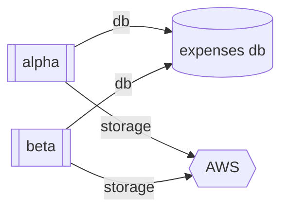

# Acme: Tool Comparison

**Prepared by:** Bonham Technologies · **Generated:** 2026-11-08 12:00 UTC · **Tools:** `alpha`, `beta`

> Rendered from `comparison/comparison.json`. Prose sections are model-written (stub/stub-model);
> every table and diagram is generated directly from the per-tool analysis. Tools without a model
> analysis appear in the risk table only.

## 1. Tools reviewed

PROSE Write one paragraph per tool, in the ord

| Tool | Purpose | Actors | Capabilities | Source lines | Model analysis |
|---|---|---|---:|---:|---|
| `alpha` | Tracks expenses. | admin | 2 | 3,032 | yes |
| `beta` | Tracks expenses. | admin | 2 | 3,032 | yes |

## 2. Capability matrix

| Capability | Actor | alpha | beta | Covered by |
|---|---|---|---|---:|
| Admin Can Export Report | staff | admin can export report | admin can export report | 2 |
| Admin Can Bypass Approval | staff | admin can bypass approval | admin can bypass approval | 2 |

## 3. Integration and data map

<!-- unvarnish-diagram: integration -->

| System | Category | Tools | Details |
|---|---|---|---|
| expenses db | data store | alpha, beta | alpha: db; beta: db |
| AWS | external system | alpha, beta | alpha: storage outbound; beta: storage outbound |

## 4. Risk comparison

| Measure | alpha | beta | 
|---|---:|---:|
| Model analysis | yes | yes | 
| Files analysed | 7 | 7 | 
| Source lines | 3,032 | 3,032 | 
| Largest file (lines) | 3,008 | 3,008 | 
| Automated tests | **none** | **none** | 
| Secrets in working tree | 0 | 0 | 
| Secrets in history | 2 | 2 | 
| Client-exposed credentials / open tables | 0 / 0 | 0 / 0 | 
| Bus factor | 1 | 1 | 
| Top author share | 100% | 100% | 
| Critical or high findings | 11 | 11 | 
| Findings: high | 11 | 11 | 
| Findings: medium | 7 | 7 | 
| Findings: low | 2 | 2 | 
| Cost to fix (effort bands) | 3 S · 4 M · 4 L · 1 XL; 8 not estimated | 3 S · 4 M · 4 L · 1 XL; 8 not estimated | 
| AI tooling indicators | 2 | 2 | 
| Dependency vulnerabilities | not checked | not checked | 

## 5. Consolidation proposal

> This proposal is a starting point for the consultant's architecture work, generated from the
> matrix, the integration map, and the tool models. It is not a design.

PROSE Write the consolidation proposal in thre

### Union of capabilities

- export reports
- bypass approval

### Abstract requirements

| Requirement | Serves users of |
|---|---|
| Finance can export a report | alpha, beta |

### Recommended approach per capability

| Capability | Keep the approach of | Why |
|---|---|---|
| export reports | alpha | single data store |

### Gaps and conflicts

- no audit trail

### Open questions

- who owns the data?
